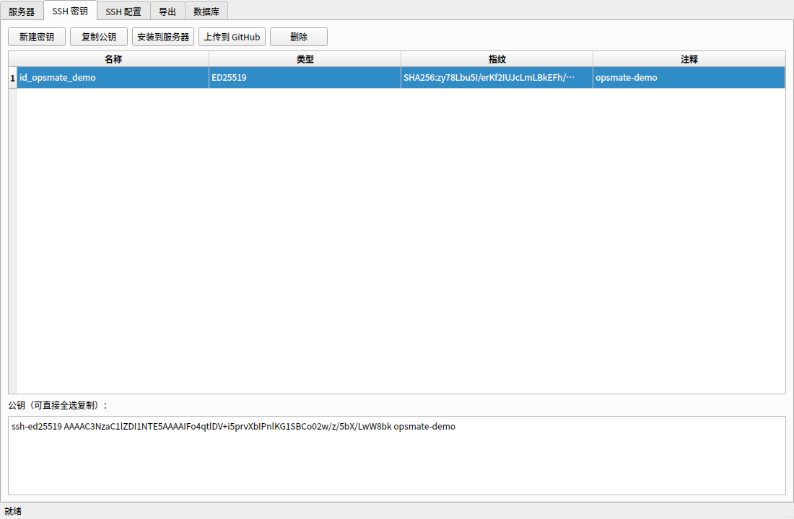

# OpsMate · 运维助手

> 本地优先的服务器运维台：**主机清单、SSH 密钥、~/.ssh/config、终端配置、数据库备份**，
> 一个窗口 / 一套命令搞定。Windows、Linux、macOS 都能跑。
>
> 蓝队云（landui.com）接入是通过第三方 SDK [`libs/LanduiSDK`](libs/LanduiSDK) 完成的，
> **本项目与蓝队云官方无任何隶属、合作或授权关系**。



## 功能

| 模块 | 能做什么 |
| --- | --- |
| 服务器清单 | 本地维护主机（名称/地址/端口/用户/认证/标签），从蓝队云一键导入，双击直连 |
| SSH 密钥 | 列出、生成（ed25519/rsa/ecdsa，可带口令）、复制公钥、装到服务器、**上传到 GitHub**、删除 |
| ~/.ssh/config | 查看、编辑、**每次写入自动备份**、把清单同步进托管块（块外内容原样保留） |
| 终端集成 | 导出 / 直接写入 **Tabby** 和 **Windows Terminal** 的 profile（写前备份） |
| 数据库 | **MySQL / PostgreSQL 全库备份与覆盖恢复**；本机客户端或 Docker 模式；**SSH 隧道（连接复用）**、**定时备份 + 保留**、**恢复前快照**、**AES-256 加密备份**、**恢复演练报告** |
| DNS 解析 | **Cloudflare** 与 **阿里云解析**：域名、记录增删改查（CLI + GUI 录入凭据） |
| 上云 | 备份自动/手动上传到 **S3 / MinIO / 阿里云 OSS**（boto3 可选） |
| 打包 | **Nuitka** 独立程序（Windows/Linux）+ **NSIS** 安装包脚本 |
| 蓝队云 | 服务器列表、开关机、防火墙（通过 LanduiSDK，见其 README） |

## 快速开始

```bash
uv sync                    # 核心（含 landui-sdk 子模块依赖）
uv sync --extra gui        # 图形界面

uv run ops-gui             # 图形界面
uv run ops doctor          # 环境自检
```

首次使用：

```bash
uv run ops hosts add --name demo --host 203.0.113.10 --port 2222 --user deploy \
    --auth key --key ~/.ssh/id_ed25519
uv run ops keys new id_ed25519 --comment "me@laptop"
uv run ops keys install demo id_ed25519      # 写进远端 authorized_keys
uv run ops keys github id_ed25519 --title "laptop"
uv run ops config sync                       # 写 ~/.ssh/config 托管块
```

## 命令一览

```bash
ops doctor [--online]             # 自检（含 ssh-keygen / gh / docker / 数据库客户端）
ops servers                       # 蓝队云实例
ops hosts list|add|rm|import      # 本地主机清单
ops keys list|new|show|install|github|delete
ops config show|backup|sync|edit  # ~/.ssh/config（自动备份）
ops export ssh|tabby|wt [--apply]
ops db list|add|rm|test|databases|backup|restore|drill|schedule|autobackup
ops dns creds list|add|rm
ops dns zones <凭据>
ops dns records <凭据> <域名>
ops dns add|update|rm ...
ops ssh <主机 ID 或名称>
```

图形界面：`ops-gui`（五个页签：服务器 / SSH 密钥 / SSH 配置 / 导出 / 数据库）。

## 数据库备份（重点）

* **MySQL**：`mysqldump --single-transaction --routines --triggers --events --add-drop-database`，
  可选「全部库」或指定库；输出 `.sql.gz`。
* **PostgreSQL**：全部库用 `pg_dumpall --clean --if-exists`（`.sql.gz`）；
  指定库用 `pg_dump -Fc` 逐库导出后打包（`.tar.gz`）。
* **恢复是覆盖式的**：MySQL 脚本自带 `DROP DATABASE`；PostgreSQL 用
  `pg_restore --clean --if-exists`。命令行必须加 `--yes`，GUI 有二次确认。
* 密码只通过环境变量 `MYSQL_PWD` / `PGPASSWORD` 传递，不进入命令行参数。
* 没有本机客户端时自动改用 Docker（`docker run --rm -i mysql:8 …`），
  镜像可配置；本机连通性用 `--network host`。

实测（Docker 真实容器，`uv run python scripts/db_docker_test.py`）：

```
→ MySQL：备份 → DROP DATABASE demo → 恢复 → 行数 2 ✅
→ PostgreSQL：pg_dump -Fc → DROP TABLE → pg_restore --clean → 行数 2 ✅
```

备份文件默认在 `~/.config/opsmate/backups/db/`。

## DNS 解析

```bash
ops dns creds add cf --provider cloudflare     # 粘贴 API Token（不回显）
ops dns creds add ali --provider aliyun        # AccessKeyId + Secret
ops dns zones cf
ops dns records cf example.com
ops dns add cf example.com --name www --type A --content 203.0.113.10 --proxied
ops dns update cf example.com <record_id> --content 203.0.113.11
ops dns rm cf example.com <record_id> --yes
```

* Cloudflare 走 API Token；阿里云走 Aliyun DNS RPC（HMAC-SHA1 签名，已含在代码里）
* 凭据存 `~/.config/opsmate/dns.json`（0600），建议用只含 DNS 权限的 RAM 子账号
* GUI「DNS」页签：可直接添加/删除凭据、选域名、记录增删，支持代理开关与线路

## 打包（Nuitka + NSIS）

```bash
uv sync --extra gui --extra build
uv run python packaging/build.py --all     # CLI + GUI
```

产物：`dist/ops.dist`、`dist/OpsMate.dist`。
Windows 安装包：`makensis packaging\installer.nsi` → `dist\OpsMate-Setup-*.exe`。
详见 [`packaging/README.md`](packaging/README.md)。

> 已在 Linux 实测：CLI 与 GUI 的 Nuitka standalone 均构建成功并可运行；
> Windows 的构建/安装包脚本已就绪，待你在 Windows 上验证。

## 文件位置

| 内容 | 路径 |
| --- | --- |
| 主机清单 / 数据库目标 | `~/.config/opsmate/hosts.json`、`databases.json`（0600） |
| 备份 | `~/.config/opsmate/backups/` |
| 导出片段 | `~/.config/opsmate/exports/` |
| SSH 密钥 | `~/.ssh/` |
| 蓝队云登录态 | `~/.config/landui-sdk/auth.json`（复用，不复制） |

Windows 下配置目录是 `%APPDATA%\opsmate`，其余路径同样基于用户主目录。

## 开发

```bash
uv run pytest -q          # 54 个离线测试
uv run ruff check src tests
uv run python scripts/db_docker_test.py   # 需要 docker
```

依赖的蓝队云 SDK 以 **git submodule** 放在 `libs/LanduiSDK`：

```bash
git clone --recurse-submodules <repo>
# 或
git submodule update --init --recursive
```

## 许可

MIT。第三方接口与破坏性操作（覆盖恢复、删除密钥）的风险由使用者承担。
